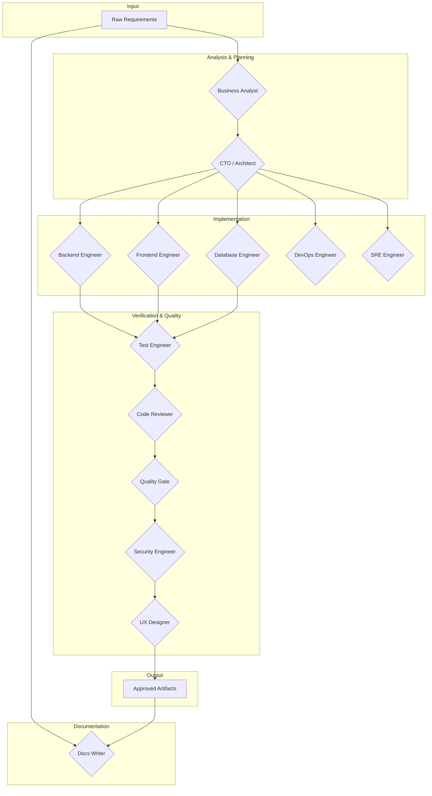

# AI Provider Agents

This repository contains a multi-agent software development lifecycle (SDLC) ecosystem that orchestrates autonomous AI agents to go from raw requirements to production-ready code.

## Architecture

```
┌──────────────────────────────────────────────────────────────────┐
│                        AI Hosts                                  │
│  ┌──────────────┐  ┌──────────────┐  ┌─────────────────────┐    │
│  │  Claude Code  │  │   Opencode   │  │  Antigravity / etc  │    │
│  └──────┬───────┘  └──────┬───────┘  └──────────┬──────────┘    │
│         │                 │                     │               │
│         └─────────────────┼─────────────────────┘               │
│                           │ MCP Protocol                        │
├───────────────────────────┼──────────────────────────────────────┤
│                    OpenClaw MCP Server                           │
│  ┌──────────────────────────────────────────────────────────┐   │
│  │  Agent Registry (capability-based)                       │   │
│  │  ┌─────┐ ┌──────┐ ┌───────┐ ┌─────┐ ┌─────┐ ┌─────┐    │   │
│  │  │ BA  │ │ CTO  │ │Backend│ │Front│ │ DB  │ │ ... │    │   │
│  │  └─────┘ └──────┘ └───────┘ └─────┘ └─────┘ └─────┘    │   │
│  └──────────────────────────────────────────────────────────┘   │
│                           │                                      │
│  ┌──────────────────────────────────────────────────────────┐   │
│  │  Infrastructure Layer                                    │   │
│  │  ┌──────────┐ ┌──────────┐ ┌──────────┐ ┌──────────┐   │   │
│  │  │ pgvector │ │ Logfire  │ │  Redis   │ │ JSONL    │   │   │
│  │  │ (Memory) │ │ (Traces) │ │ (Cache)  │ │ (Logs)   │   │   │
│  │  └──────────┘ └──────────┘ └──────────┘ └──────────┘   │   │
│  └──────────────────────────────────────────────────────────┘   │
│                           │                                      │
│  ┌──────────────────────────────────────────────────────────┐   │
│  │  Pipeline Orchestrator (BA → Advisory → Impl → Gate)    │   │
│  └──────────────────────────────────────────────────────────┘   │
└──────────────────────────────────────────────────────────────────┘
```

## Agent Interaction Flow (Mermaid Diagram)



## Getting Started

For detailed instructions on how to set up and run the project, please see the [agents/README.md](agents/README.md) file.

## Project Structure

This repository is the central configuration hub for all AI agent providers in the ecosystem. Provider configs live here; each provider gets a thin workspace under `programming/ai/<provider>/` with symlinks back to shared templates and agent definitions.

For a detailed explanation of the project structure, see the [Multi-Provider Structure](agents/README.md#--multi-provider-structure) section in the `agents/README.md` file.

## Detailed Documentation

For a full breakdown of the project, including agent capabilities, API references, and pipeline flows, please refer to the comprehensive [agents/README.md](agents/README.md).
