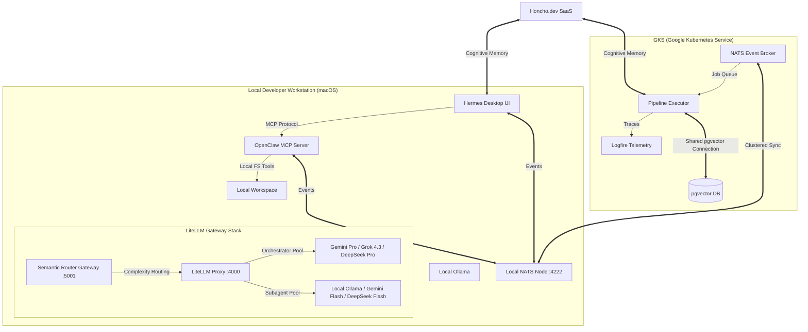

> **ARCHIVED (2026-10-14).** This repo is retired. The agents, orchestration pipeline and MCP server now live in
> [mediusfy/pydantic_agents](https://github.com/mediusfy/pydantic_agents) (v0.2.0+), deployed from
> `k8s/charts/agents` in `mediusfy/infrastructure` as the `pydantic-agents` release. litellm tools are named
> `pydantic_agents-run_<agent>`.

# AI Provider Agents & SDLC Ecosystem

This repository is the central hub for our hybrid, multi-agent Software Development Lifecycle (SDLC) ecosystem. It orchestrates autonomous AI agents to progress from raw requirements to production-ready, validated code across local developer environments and cloud nodes.

---

## 🏗️ Architecture Overview

The ecosystem operates on a **hybrid execution model**, routing tasks between cloud infrastructure (**GKS**) and the local developer workstation (**macOS**) depending on resource consumption and sandbox needs.



### Key Architectural Pillars

1. **LiteLLM Gateway (Port `4000`)**: A unified proxy that isolates API credentials and organizes models into functional pools:
   * **Orchestrator Pool (Heavy Reasoning)**: Mapped to premium reasoning models like **x.ai Grok 4.3**, **Gemini 2.5 Pro**, and **DeepSeek-V4-Pro**.
   * **Subagent Pool (High Volume)**: Mapped to fast, cost-efficient endpoints like **Ollama/qwen2.5-coder:7b** (local), **DeepSeek-V4-Flash**, and **Gemini 2.5 Flash**.
2. **Semantic Router (Port `5001`)**: A lightweight Python-based FastAPI gateway that runs a local HuggingFace encoder (`all-MiniLM-L6-v2`) to dynamically direct incoming queries:
   * Simple scaffolding, docs, or testing prompts route to the cheap **`subagent`** pool.
   * Complex logic, design, or architecture prompts route to the high-intelligence **`orchestrator`** pool.
3. **NATS Event Bus (Port `4222`)**: Facilitates reliable, asynchronous event-driven collaboration between agent microservices and pipeline stages.
4. **Honcho Memory Integration**: Integrated as the cognitive memory layer to maintain state, context, and conversational session history across agent sessions.

---

## 📂 Project Structure

```
.
├── docker-compose.yml       # LiteLLM, Postgres, Redis, and NATS containers
├── config.yaml              # LiteLLM routing definitions, fallbacks, and model groups
├── services/
│   ├── semantic-router/     # FastAPI Semantic Router gateway using local embeddings
│   └── internal/adapters/   # Go adapters including the real NATS event bus
└── README.md                # This file
```

---

## 🚀 Getting Started

### 1. Start the Local Service Stack
Initialize the LiteLLM gateway, NATS event broker, Postgres, and Redis:
```bash
# Sourcing environment variables from envs.zsh injects GEMINI, DEEPSEEK, and XAI keys
source ~/.zsh/envs.zsh
docker compose up -d
```

### 2. Start the Semantic Router Gateway
Start the local Python-based gateway (which handles offline routing classification):
```bash
cd services/semantic-router
chmod +x start.sh
./start.sh
```

### 3. Verify System Health
* **LiteLLM Readiness**: `curl http://localhost:4000/health/readiness`
* **Semantic Router Health**: `curl http://localhost:5001/healthz`
* **Direct Prompt Routing Test**:
  ```bash
  curl -X POST http://localhost:5001/v1/chat/completions \
    -H "Content-Type: application/json" \
    -H "Authorization: Bearer <LITELLM_MASTER_KEY>" \
    -d '{
      "model": "default",
      "messages": [{"role": "user", "content": "write unit tests for this function"}],
      "stream": false
    }'
  ```

---

## 📈 Monitoring Local Compute vs Cloud
To see how much Ollama is processing locally versus paid cloud APIs:
* **SQL Query**: Run stats directly against the spend database:
  ```bash
  docker exec llm-lite-postgres-1 psql -U litellm -d litellm -c \
    "SELECT model, COUNT(*) as request_count, SUM(completion_tokens + prompt_tokens) AS total_tokens FROM \"LiteLLM_SpendLogs\" GROUP BY model ORDER BY total_tokens DESC;"
  ```
* **Visual Dashboard**: Log into `http://localhost:4000/ui` using your master key to view usage charts.
# agent-docs
