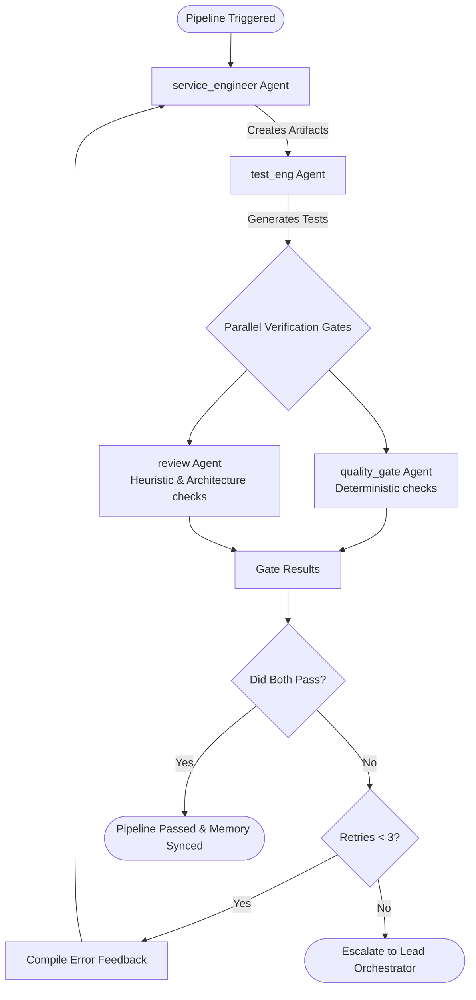

# Existing Code Pipeline

Modifies EXISTING Go codebases through a multi-agent pipeline with self-check and cross-review gates.

## When to Use

- Adding handlers to an existing service
- Wiring new dependencies into existing code
- Refactoring without changing behavior
- Fixing bugs in established codebases
- Adding observability (tracing, metrics) to existing operations
- Extending existing functionality (not scaffolding new services)

## Entry Points

### 1. opencode — `service-coder` primary agent

Select the `service-coder` agent in opencode. It self-checks against CODING_STANDARDS.md, then delegates to:

1. `library-curator` — no reinvented wheels
2. `test-generator` — table-driven tests
3. `code-inspector` — over-engineering, DRY, pattern drift
4. `functional-tester` — verify tests pass
5. `architect` — architectural fit

### 2. MCP tool — `modify_existing_code`

Available via the `openclaw-agents` MCP server. Call from any MCP client:

```
modify_existing_code(
    change_description="Add OpenTelemetry tracing to the ProcessMessage handler in internal/service/message.go",
    codebase_path="/path/to/existing/service"
)
```

Runs: service_engineer (pydantic_ai) → test_eng → quality_gate → review

### 3. Claude Code — `existing-code-workflow` rule

`.claude/rules/existing-code-workflow.md` activates automatically when you describe changes to existing code. Includes the full self-check checklist and cross-review criteria.

## Architecture

The pipeline uses an **Autonomous Remediation Loop** with **Parallel Verification Gates**. Instead of failing out immediately or running sequentially, the pipeline attempts to auto-fix code up to 3 times by feeding gate failures back to the `service_engineer`.



## Quality Rules Enforced

| Rule | Where | How |
|------|-------|-----|
| Library-first | service_engineer prompt | No custom hashmap/retry/date parser |
| DRY | service_engineer prompt + code-inspector | 3+ repeated lines → extract |
| No premature abstraction | quality_gate + code-inspector | 1-impl interfaces are not interfaces |
| YAGNI | service_engineer prompt | No config knobs "for the future" |
| Table-driven tests | go_test_agent | testify, mockery, t.Parallel() |
| CODING_STANDARDS | self-check + review | All Go code checked against CODING_STANDARDS.md |
| Pattern drift | code-inspector | Compare against same-package existing code |
| Pass tests | functional-tester | go test ./... must be green |
