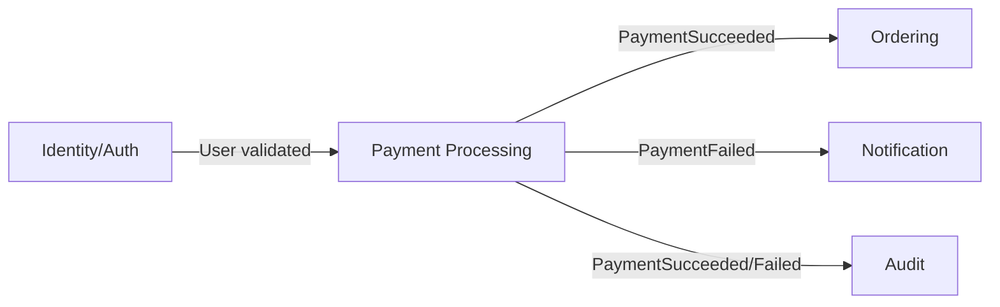

# Payment Processing Bounded Context

## Classification
**Core Domain** — Payment processing is a competitive differentiator, not a generic subdomain.

## Ubiquitous Language

| Term | Definition |
|------|-----------|
| **Payment** | Aggregate Root. Represents the entire lifecycle of a payment from initiation to completion. |
| **Transaction** | Child value object of Payment. Represents a single attempt to process a payment through a gateway. |
| **PaymentGateway** | External upstream service that authorizes and captures payment. |
| **Idempotency Key** | UUID v4 assigned to each Payment to guarantee exactly-once processing. |
| **RegionRouter** | Component that maps payment origin country to the correct regional data store and gateway endpoint. |
| **CircuitBreaker** | Per-region, per-gateway resiliency pattern that rejects fast when failure threshold is exceeded. |
| **Transactional Outbox** | Pattern ensuring domain events are persisted atomically with aggregate state in the same DB transaction. |

## State Machine

```
Initiated -> Validated -> Processing -> Succeeded
                                      -> Failed
```

## Domain Events

| Event | Trigger | Description |
|-------|---------|-------------|
| `PaymentInitiated` | Internal | Payment aggregate created with idempotency key |
| `PaymentValidated` | Internal | Input validation passed |
| `PaymentSucceeded` | External (EVT-001) | Payment successfully authorized and captured |
| `PaymentFailed` | External (EVT-002) | Payment declined, gateway error, or timeout |
| `PaymentGatewayTimedOut` | Internal | Upstream gateway exceeded timeout threshold |
| `PaymentRetryAttempted` | Internal | Retry initiated after gateway timeout |

## Context Map



- **Ordering Context**: Listens to `PaymentSucceeded` to mark order as paid
- **Notification Context**: Listens to `PaymentFailed` to alert user
- **Audit Context**: Listens to all events for immutable audit trail

## Architectural Patterns

1. **Transactional Outbox + CDC** — Events written atomically with aggregate state; Debezium/Kafka Connect streams to message bus
2. **CQRS Readiness** — Read-optimized `payment_ledger` table populated asynchronously from outbox stream
3. **Event Sourcing Readiness** — Append-only event stream co-located in same DB; outbox serves as source of truth
4. **Saga Orchestration** — For cross-region payment flows, compensating events via choreographed saga

## Multi-Cloud Strategy

- **RegionRouter**: Maps `payment.origin_country_code` to specific regional shard
- **Per-region data stores**: EU → eu-west-1, US → us-east-1, APAC → ap-southeast-1
- **Data never migrates** across regional boundaries
- **Control plane** in neutral region with no PII for saga coordination

## Resiliency Patterns

| Pattern | Configuration |
|---------|--------------|
| Retry | Exponential backoff: base 200ms, cap 10s, jitter 10% |
| Circuit Breaker | Sliding window error rate, per-region and per-gateway |
| Bulkhead | Dedicated thread pool per gateway endpoint (max concurrent + 10%) |
| Timeout | Per-region: EU 2s, US 2s, APAC 5s |

## User Stories

| ID | Title | Event |
|----|-------|-------|
| US-001 | Successful payment processing | PaymentSucceeded |
| US-002 | Failed payment from gateway decline | PaymentFailed |
| US-003 | Input validation rejection | None (no events emitted) |
| US-004 | Data residency compliance routing | Depends on outcome |
| US-005 | Network latency retry logic | PaymentFailed on exhaustion |
