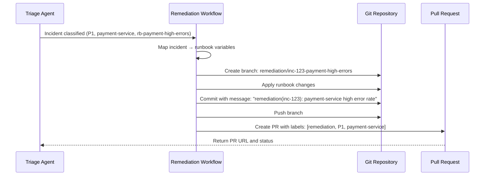

# GitOps-Native Remediation Theme

> **Stories**: GITOPS-01 · GITOPS-02 · GITOPS-03 · GITOPS-04  
> **Priority**: P0 (3 stories) + P1 (1 story)  
> **Phase**: Phase 1 — Foundation & Core Automation

---

## Theme Overview

The GitOps-Native Remediation theme operationalizes the principle that **all remediation actions should follow the GitOps workflow**: declarative, version-controlled, reviewed, and auditable. Every incident response is a Pull Request; every runbook is a versioned YAML file; every policy is code.

---

## Story Flow

```
                    ┌──────────────────────┐
                    │  Incident Classified  │
                    │  (from Triage Agent)  │
                    └──────────┬───────────┘
                               │
                               ▼
┌─────────────────────────────────────────────────────────────────────┐
│                    GITOPS-01: Remediation PR                        │
│                                                                     │
│  1. Remediation workflow receives classified incident + runbook     │
│  2. Maps incident context to runbook template variables             │
│  3. Renders runbook changes as a Git diff                           │
│  4. Creates PR with proper title, description, labels               │
│  5. References incident ID in commit message                        │
└────────────────────────────────┬────────────────────────────────────┘
                                 │
                                 ▼
┌─────────────────────────────────────────────────────────────────────┐
│                    GITOPS-04: Policy Evaluation                     │
│                                                                     │
│  1. Policy engine evaluates PR against all defined policies         │
│  2. Tags PR with required approvers based on:                       │
│     - Severity level (P0-P4)                                        │
│     - Affected service                                              │
│     - Environment (prod/staging/dev)                                │
│  3. P0 production → 2+ approvers including SRE lead                 │
└────────────────────────────────┬────────────────────────────────────┘
                                 │
                                 ▼
┌─────────────────────────────────────────────────────────────────────┐
│                    GITOPS-03: Audit + Rollback                      │
│                                                                     │
│  1. PR is reviewed, approved, and merged                            │
│  2. Complete audit trail recorded:                                  │
│     - Who approved, what changed, when deployed                     │
│     - Git commit SHA, diff summary                                  │
│     - Signed commits for compliance                                 │
│  3. Rollback available as one-click revert PR                       │
└─────────────────────────────────────────────────────────────────────┘
```

---

## Story Details

### GITOPS-01: Automated Incident Response via GitOps PRs

**Acceptance Criteria:**
- ✅ Incident classification triggers automated remediation workflow
- ✅ Runbook-specific changes are rendered as a Git diff
- ✅ GitOps PR is created with proper title, description, and labels
- ✅ PR references the incident ID in the commit message
- ✅ PR creation is idempotent (no duplicate PRs for same incident+runbook combination)

**Key Endpoints:**

| Method | Path | Description |
|--------|------|-------------|
| `POST` | `/api/v1/gitops/remediations` | Create remediation PR |
| `GET` | `/api/v1/gitops/remediations` | List remediation PRs |
| `GET` | `/api/v1/gitops/remediations/{id}` | Get remediation details |

**Example Remediation PR Flow:**



---

### GITOPS-02: Declarative Runbook Definitions Stored in Git

**Runbook YAML Schema:**

```yaml
# Example: runbooks/database/failover.yaml
name: database-failover
description: "Automated failover for primary database instances"
version: 1.2.0
service: database
severity: [P0, P1]
environments: [production, staging]

trigger_conditions:
  metric: database_connection_errors
  operator: gt
  threshold: 100
  duration_seconds: 300

steps:
  - step_number: 1
    name: Identify current primary
    action: execute_query
    parameters:
      query: "SHOW PRIMARY"
      timeout_seconds: 10

  - step_number: 2
    name: Promote replica to primary
    action: run_script
    parameters:
      script: "promote_replica.sh"
      args: ["${new_primary}", "${region}"]
    rollback_step: "rollback-step-2"

  - step_number: 3
    name: Update DNS records
    action: api_call
    parameters:
      url: "https://dns-api.internal/update"
      method: PUT
      body:
        record: "db.${region}.internal"
        target: "${new_primary}"

rollback_procedure:
  steps:
    - step_number: 1
      name: rollback-step-2
      action: run_script
      parameters:
        script: "demote_replica.sh"
        args: ["${new_primary}"]
  estimated_time_seconds: 45

approval_requirements:
  min_approvers: 2
  required_roles: ["sre", "database-admin"]
  auto_approve: false
```

**Acceptance Criteria:**
- ✅ Runbook YAML schema is defined and versioned
- ✅ Schema validation occurs on commit (via webhook or CI)
- ✅ Runbook contains all required sections: triggers, steps, rollback, approvals, severity
- ✅ Invalid runbooks are rejected with clear error messages
- ✅ Runbook registry is queryable via API

---

### GITOPS-03: Audit Trail and Rollback via Git History

**Audit Trail Data Model:**

```
Incident: inc-20260603-001
  │
  ├── Remediation PR: #42 (merged)
  │   ├── Actor: sre-bob (approver)
  │   ├── Commit: a1b2c3d4e5f6...
  │   ├── Changes: 15 additions, 3 deletions
  │   ├── Files: runbooks/database/failover.yaml
  │   ├── Deployed: 2026-06-03T02:30:00Z
  │   └── Rollback: PR #43 (created but not merged)
  │
  └── Compliance Export (JSON/CSV)
```

**Acceptance Criteria:**
- ✅ Every remediation PR creates a verifiable audit trail in Git history
- ✅ Audit query returns: approver identity, diff summary, deployment timestamp, rollback commit SHA
- ✅ Rollback is a single-click operation that creates a revert PR
- ✅ Audit trail is immutable (signed commits, branch protection)
- ✅ API endpoint exposes audit history for compliance queries

---

### GITOPS-04: Policy-as-Code for Remediation Approval Gates

**Example Rego Policy:**

```rego
# policies/approval-gates.rego
package rufkis.approval

default required_approvers = []

# P0 Production changes require SRE Lead approval
required_approvers = ["sre-lead"] {
    input.severity == "P0"
    input.environment == "production"
}

# P1 Production changes require at least 1 SRE engineer
required_approvers = ["sre-engineer"] {
    input.severity == "P1"
    input.environment == "production"
}

# Payment service changes always require payment-team approval
required_approvers = ["payment-sre-lead"] {
    input.service == "payment-service"
    input.environment == "production"
}

# Count minimum approvers
min_approvers = 2 {
    input.severity == "P0"
    input.environment == "production"
}

min_approvers = 1 {
    input.environment != "production"
}
```

**Acceptance Criteria:**
- ✅ Policy engine evaluates every remediation PR via webhook
- ✅ Policies are defined as code (Rego/OPA) and stored in a policies directory
- ✅ Required approvers are dynamically assigned based on severity, service, environment
- ✅ P0 production changes require 2+ approvers including an SRE lead
- ✅ Policy violations block PR merge with clear rejection reasons

---

## API Endpoints Summary

| Method | Path | Story | Description |
|--------|------|-------|-------------|
| `POST` | `/gitops/remediations` | GITOPS-01 | Create remediation PR |
| `GET` | `/gitops/remediations` | GITOPS-01 | List remediation PRs |
| `GET` | `/gitops/remediations/{id}` | GITOPS-01 | Get remediation details |
| `POST` | `/gitops/remediations/{id}/rollback` | GITOPS-03 | Rollback remediation |
| `GET` | `/gitops/runbooks` | GITOPS-02 | List runbooks |
| `GET` | `/gitops/runbooks/{id}` | GITOPS-02 | Get runbook definition |
| `POST` | `/gitops/runbooks/validate` | GITOPS-02 | Validate runbook YAML |
| `GET` | `/gitops/audit` | GITOPS-03 | Query audit trail |
| `GET` | `/gitops/audit/{incident_id}` | GITOPS-03 | Get incident audit history |
| `POST` | `/gitops/policies/evaluate` | GITOPS-04 | Evaluate PR against policies |
| `GET` | `/gitops/policies` | GITOPS-04 | List defined policies |

---

## Dependencies

| Story | Depends On | Provides To |
|-------|-----------|-------------|
| GITOPS-01 | TRIAGE-01, GITOPS-02 | GITOPS-03, GITOPS-04 |
| GITOPS-02 | — | GITOPS-01, WORKSPACE-02 |
| GITOPS-03 | GITOPS-01 | — |
| GITOPS-04 | GITOPS-01 | — |

---

## Implementation Tasks

| Task | Effort | Description |
|------|--------|-------------|
| GITOPS-01-T1 | 3d | RemediationWorkflow engine |
| GITOPS-01-T2 | 3d | Git provider abstraction layer |
| GITOPS-01-T3 | 2d | PR templating engine |
| GITOPS-02-T1 | 2d | Runbook YAML schema definition |
| GITOPS-02-T2 | 2d | Schema validation service |
| GITOPS-02-T3 | 2d | Runbook registry API |
| GITOPS-03-T1 | 3d | Audit trail data model |
| GITOPS-03-T2 | 2d | Audit query API |
| GITOPS-03-T3 | 2d | One-click rollback |
| GITOPS-04-T1 | 3d | OPA/Rego policy engine integration |
| GITOPS-04-T2 | 2d | Rego policies for approval gates |
| GITOPS-04-T3 | 2d | Webhook handler for PR evaluation |

**Total Effort: 24 days**
