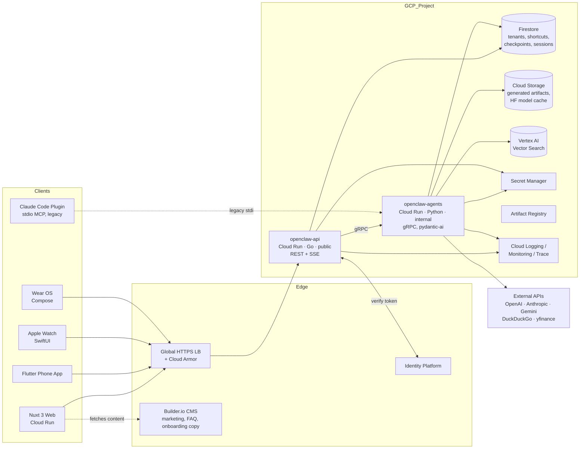

# openclaw — GCP Hosting & Product Architecture Plan

> Target: Cloud Run-first deployment of openclaw as a multi-client product (web, mobile, watch) backed by a Go API edge and a Python pydantic-ai agent service.

## Table of contents

1. [Executive summary](#1-executive-summary)
2. [Current state of openclaw + what blocks hosting](#2-current-state-of-openclaw--what-blocks-hosting)
3. [Target architecture](#3-target-architecture)
4. [Compute: Cloud Run config + cost sketch + GKE escape hatch](#4-compute-cloud-run-config--cost-sketch--gke-escape-hatch)
5. [Backend split: Go API + Python agents, gRPC boundary](#5-backend-split-go-api--python-agents-grpc-boundary)
6. [Frontend: Nuxt web app, Builder.io split, marketing chatbot](#6-frontend-nuxt-web-app-builderio-split-marketing-chatbot)
7. [Mobile: Flutter phone app](#7-mobile-flutter-phone-app)
8. [Watch apps: Apple Watch + Wear OS](#8-watch-apps-apple-watch--wear-os)
9. [Shortcuts feature: data model, API, cross-client surface](#9-shortcuts-feature-data-model-api-cross-client-surface)
10. [Auth + tenancy + one-click onboarding](#10-auth--tenancy--one-click-onboarding)
11. [Data layer: Firestore vs Cloud SQL, GCS, vector store choice](#11-data-layer-firestore-vs-cloud-sql-gcs-vector-store-choice)
12. [Observability + cost monitoring](#12-observability--cost-monitoring)
13. [IaC with OpenTofu](#13-iac-with-opentofu)
14. [CI/CD pipelines per service](#14-cicd-pipelines-per-service)
15. [Secrets + security](#15-secrets--security)
16. [Phased rollout](#16-phased-rollout)
17. [Open questions for user review](#17-open-questions-for-user-review)

---

## 1. Executive summary

Ship openclaw as a managed product on GCP using two Cloud Run services — a public Go API edge (`openclaw-api`, REST + SSE) and an internal Python agent runtime (`openclaw-agents`, gRPC, wrapping pydantic-ai). State that lives on local disk today (ChromaDB, checkpoints, generated artifacts, HF embedding cache) moves to Firestore + GCS + Vertex AI Vector Search. Clients are a Nuxt 3 web app (Builder.io for marketing/CMS surfaces, app-owned chat + shortcut editor), a Flutter phone app, and native watch apps (watchOS + Wear OS). Identity Platform handles auth with one-click sign-in and auto-provisioned tenants. Infra is OpenTofu in one project, one region, GCS-backed state. The plan assumes solo-operator economics — Cloud Run scale-to-zero, no GKE — with a clear escape hatch documented for when sustained concurrency makes GKE Autopilot cheaper.

## 2. Current state of openclaw + what blocks hosting

openclaw today is a Python 3.11 multi-agent SDLC pipeline built on pydantic-ai. Three entrypoints exist:

- CLI runner at `main.py`.
- FastMCP server over **stdio** at `src/openclaw/mcp_server.py` — usable by Claude Code but not network-addressable.
- A Claude Code plugin packaging the agents.

What blocks hosting:

- **No HTTP/gRPC server.** MCP-over-stdio assumes a parent process owns the lifecycle. Cloud Run needs a long-running listener on `$PORT`.
- **No Dockerfile in this repo.** The Helm chart at `homeLab_infra_IaC/k8s/charts/openclaw` exists but points at an image that isn't built here.
- **Local filesystem state.** `.claw-vectordb/` (ChromaDB, see `src/openclaw/vector_db.py`), `.claw-checkpoints/` (see `src/openclaw/checkpoint.py`), and `./generated-app/<project>/` (see `src/openclaw/writer.py`) all assume a writable local FS that persists across runs. Cloud Run containers are ephemeral.
- **Slow cold paths.** First run downloads HuggingFace sentence-transformers (the `sentence-transformers` dep in `pyproject.toml`). A cold Cloud Run instance hitting that is a 30–90s tax per scale-from-zero.
- **Long-running invocations.** Runs can take minutes; SDLC pipelines chain agents. Cloud Run's request timeout (max 60min, default 5min) is workable but needs streaming + checkpoint resumption.
- **No multi-tenancy.** Config is global (`src/openclaw/settings.py`, `src/openclaw/config.py`); checkpoints are keyed by project name on disk with no tenant scope.
- **API keys via env vars.** OpenAI, Anthropic, Gemini, DuckDuckGo, yfinance — currently `.env`/process env, not Secret Manager.

None of these are deep architectural problems. They're a packaging + storage migration.

## 3. Target architecture

One GCP project, one region (assume `us-central1` — confirm in §17). Two Cloud Run services, three data stores, one identity provider, one CDN-fronted web app, three mobile/wearable clients.



Key shapes:

- **Edge = Go.** All client traffic (web, phone, watches, marketing chatbot) terminates at `openclaw-api`. Go handles auth verification, rate limiting, SSE fan-out, request shaping. Nothing pydantic-ai-shaped leaks out.
- **Agents = Python, internal-only.** `openclaw-agents` is `--no-allow-unauthenticated`; only the Go service's runtime SA can invoke it. gRPC streaming carries agent progress events back to Go which re-emits as SSE.
- **State is all managed.** Firestore (low-write metadata), GCS (large blobs), Vertex AI Vector Search (embeddings). No persistent disks, no Cloud SQL in the MVP path.
- **The Claude Code plugin still works** against a local stdio MCP shim — the hosted product is additive, not a replacement, for solo/dev usage.

## 4. Compute: Cloud Run config + cost sketch + GKE escape hatch

### 4.1 `openclaw-api` (Go, public)

| Setting | Value | Why |
|---|---|---|
| CPU allocation | **Request-based** | Idle requests are rare on Go edge; pay only during requests. |
| CPU | 1 vCPU | Go is cheap; this is mostly I/O and SSE pumping. |
| Memory | 512 MiB | Headroom for SSE buffers + Firestore SDK. |
| Concurrency | **80** | Standard Cloud Run default; Go handles this easily. |
| Min instances | **0** | Scale to zero out of hours. Cold start is ~200ms for a Go binary. |
| Max instances | 20 | Cap blast radius and bill. |
| Request timeout | **60 min** | SSE streams from long-running agent runs. |
| Ingress | All | Public. Front with Global HTTPS LB + Cloud Armor. |
| Auth | Allow unauthenticated | App-level auth via Identity Platform JWT. |

### 4.2 `openclaw-agents` (Python, internal)

| Setting | Value | Why |
|---|---|---|
| CPU allocation | **Always-allocated** | Background work between request chunks (LLM calls, vector queries, file writes to GCS) keeps CPU active; request-based throttles these. |
| CPU | 2 vCPU | sentence-transformers init + parallel LLM I/O. |
| Memory | **2 GiB** | HF embedding model + ChromaDB shim or Vertex client + pydantic-ai working set. |
| Concurrency | **1** | Each agent run is stateful, multi-minute, with large per-request memory; isolate per instance. |
| Min instances | **1** | Pin one warm instance to absorb the 30–90s cold start (HF model load). Solo-dev acceptable; raise later. |
| Max instances | 10 | Cap parallel SDLC pipelines. |
| Request timeout | **60 min** | Long-running runs; resumable via Firestore checkpoints if a request is killed. |
| Ingress | **Internal** | Only Cloud Run-to-Cloud Run traffic. |
| Auth | **Require authenticated** | `roles/run.invoker` granted to `openclaw-api`'s runtime SA only. |
| Startup CPU boost | **On** | Shortens cold-start model load. |
| Health check | gRPC health probe | Standard. |
| Execution env | Gen2 | Required for gRPC streaming + larger memory. |

### 4.3 Cost sketch

Numbers below are list-price for `us-central1` as of May 2026 and ignore the always-free tier (which would meaningfully reduce the 100/day row). Pricing reference: Cloud Run docs — verify before committing in §17. LLM API costs are excluded; those dominate at every scale.

Assumptions per request:
- API: 200ms wall, 1 vCPU, 512 MiB.
- Agents: 90s wall (median SDLC sub-task), 2 vCPU, 2 GiB, always-allocated.
- 1 KiB egress per request from API.
- Min=1 on agents service means we pay for one instance 24/7 regardless of traffic.

Cloud Run pricing (request-based, approx):
- vCPU-second: $0.000024
- GiB-second: $0.0000025
- Request: $0.40 / million

Cloud Run pricing (always-allocated): vCPU-second $0.0000180, GiB-second $0.0000020, no per-request fee.

**Min=1 baseline on agents service** (always on, 2 vCPU + 2 GiB, always-allocated):
- vCPU: 2 × 2,592,000 s/mo × $0.0000180 = **~$93/mo**
- Memory: 2 × 2,592,000 s/mo × $0.0000020 = **~$10/mo**
- **Floor: ~$103/mo** before any request.

Per-request marginal cost on agents (90s × 2 vCPU × $0.0000180 + 90s × 2 GiB × $0.0000020) = ~$0.0036/run.
Per-request marginal cost on API (0.2s × 1 vCPU × $0.000024 + 0.2s × 0.5 GiB × $0.0000025 + $0.0000004) ≈ ~$0.0000076/req — negligible at these volumes.

| Volume | Agent runs/mo | Marginal Cloud Run | + Floor | Cloud Run total/mo |
|---|---|---|---|---|
| 100 req/day | 3,000 | $11 | $103 | **~$114** |
| 1,000 req/day | 30,000 | $108 | $103 | **~$211** |
| 10,000 req/day | 300,000 | $1,080 | $103 | **~$1,183** |

LLM tokens + Firestore + GCS + egress are extra. At 10k/day, LLM API spend likely dwarfs compute by 5–20×; that's the real cost knob, not Cloud Run.

If min=0 on agents (acceptable if cold start can be reduced — see §5), the floor goes to ~$0 and the 100/day row drops to ~$11/mo, but every cold start is 30–90s. Not user-acceptable on interactive endpoints.

### 4.4 If you outgrow Cloud Run

Outgrow signals: agent service sustains >5 concurrent runs all day, min-instance count climbs past 3–4, or you need GPUs for local embeddings.

| Option | When it wins | Where it hurts |
|---|---|---|
| **Cloud Run (status quo)** | Bursty traffic, scale-to-zero off-hours, solo/small team. | Min-instance floor for warm starts; concurrency=1 wastes CPU when idle within a request. |
| **GKE Autopilot** | Sustained concurrency where 3–4 warm Cloud Run instances run 24/7. You're already paying Autopilot-equivalent prices — and on Autopilot, **you bill per pod request/limit** (vCPU + memory requested, not used). Cheaper than Cloud Run only if you size requests tightly and keep utilization high. Adds k8s primitives (Jobs, CronJobs, multi-container pods, sidecars), which Cloud Run lacks. |
| **GKE Standard** | You need GPUs, custom node pools, spot/preemptible nodes, or tight kernel/networking control. **Costs scale with provisioned node capacity, not pod requests** — empty nodes still bill. Cheapest at high sustained scale where you can pack pods densely; worst at low/bursty scale. |

The Helm chart at `homeLab_infra_IaC/k8s/charts/openclaw` is the escape hatch — switching to GKE is repackaging, not a rewrite. Until traffic justifies it, the floor cost of GKE control plane + idle nodes loses to Cloud Run.

## 5. Backend split: Go API + Python agents, gRPC boundary

### 5.1 Why split

Today everything sits in Python behind stdio MCP. The split solves three problems at once:

- **Public surface is small and fast.** Go handles auth, rate limiting, SSE, request fan-out, idempotency. It cold-starts in ~200ms; Python cold-starts in 30–90s.
- **Agent code stays Python.** pydantic-ai, langchain, sentence-transformers — no rewrite. Python becomes an implementation detail of the agent service.
- **Cost lever.** The Python service is the expensive one (min=1, big memory). The Go service can scale to zero with no UX hit.

### 5.2 Go API responsibilities (`openclaw-api`)

- Verify Identity Platform JWTs.
- Per-tenant rate limiting (token bucket in Firestore or Redis if it gets hot).
- REST CRUD for tenants, shortcuts, sessions, run history.
- SSE streaming endpoints for chat + agent runs (`GET /v1/sessions/{id}/stream`).
- Marketing chatbot anonymous endpoint (separate rate limit table, see §6).
- Calls `openclaw-agents` over gRPC with deadline propagation + Cloud Trace context.

### 5.3 Python agent responsibilities (`openclaw-agents`)

- gRPC service `AgentRuntime` with three RPCs:
  - `RunAgent(stream RunRequest) returns (stream RunEvent)` — bidirectional streaming; events include `agent_started`, `tool_called`, `token_chunk`, `checkpoint_written`, `agent_finished`.
  - `ResumeRun(ResumeRequest) returns (stream RunEvent)` — resumes from a Firestore checkpoint.
  - `ListAgents(Empty) returns (AgentList)` — surfaces registry from `src/openclaw/registry.py`.
- pydantic-ai agents unchanged at the core. The wrapper adapts existing entrypoints to gRPC.
- Writes checkpoints to Firestore (replacing `src/openclaw/checkpoint.py` disk writes).
- Writes generated artifacts to GCS (replacing `src/openclaw/writer.py` local writes).
- Reads HF embedding model from GCS-mounted cache on startup (cuts the 30–90s download to ~5s).

### 5.4 What changes in Python (concrete checklist)

- **Add `src/openclaw/grpc_server.py`.** Hosts the gRPC service. Uses `grpc.aio` for async streaming. Listens on `$PORT` per Cloud Run contract.
- **Add Dockerfile.** Multi-stage: builder stage installs deps, runtime stage is `python:3.11-slim` (distroless once verified). Pin HF model download to a build-time step that pushes the model to GCS, then the runtime container fetches it at startup from `gs://openclaw-models/...`.
- **Replace `checkpoint.py` disk I/O.** Today checkpoints live under `.claw-checkpoints/<project>/`. Move to Firestore: collection `tenants/{tenantId}/runs/{runId}/checkpoints/{step}` with the same shape. Keep the existing public API on the `Checkpoint` class so callers don't change.
- **Replace `writer.py` local writes.** Today output goes to `./generated-app/<project>/`. Write to `gs://openclaw-artifacts/{tenantId}/{runId}/...`. Return signed URLs to the API for client download.
- **Replace ChromaDB.** Keep an adapter interface; swap implementation to Vertex AI Vector Search (see §11). Embedding generation still happens in-process via sentence-transformers.
- **Tenant scope everywhere.** `Settings` (`src/openclaw/settings.py`) is global today. Threading a `TenantContext` through agent invocations is the largest non-trivial Python change; do it once and lock it.
- **Keep stdio MCP working.** `src/openclaw/mcp_server.py` stays for the Claude Code plugin / local dev. The hosted product just adds gRPC alongside.

### 5.5 gRPC boundary contract (sketch)

```proto
service AgentRuntime {
  rpc RunAgent(stream RunRequest) returns (stream RunEvent);
  rpc ResumeRun(ResumeRequest) returns (stream RunEvent);
  rpc ListAgents(google.protobuf.Empty) returns (AgentList);
}

message RunRequest {
  string tenant_id = 1;
  string user_id = 2;
  string agent_id = 3;       // matches registry.py keys
  string session_id = 4;
  oneof payload {
    string prompt = 5;
    Shortcut shortcut = 6;
    ResumeFromCheckpoint resume = 7;
  }
}

message RunEvent {
  string run_id = 1;
  google.protobuf.Timestamp ts = 2;
  oneof event {
    AgentStarted started = 10;
    ToolCalled tool_called = 11;
    TokenChunk token = 12;
    CheckpointWritten checkpoint = 13;
    AgentFinished finished = 14;
    AgentError error = 15;
  }
}
```

Auth on the boundary: Cloud Run service-to-service. The API's runtime SA is granted `roles/run.invoker` on the agents service. Tokens are auto-minted by the Cloud Run client libraries.

## 6. Frontend: Nuxt web app, Builder.io split, marketing chatbot

### 6.1 Stack

- **Vue 3 + Nuxt 3**, Nitro preset `node-server`, deployed as a container to Cloud Run.
- **Pinia** for client state (active session, streaming buffers, shortcut drafts).
- **Composables for SSE.** `useAgentStream(sessionId)` exposes a reactive event stream; under the hood it's a `fetch` with `ReadableStream` (or `EventSource` for the marketing endpoint).
- **Tailwind** for styling. **VeeValidate + Zod** for forms.

Cloud Run config: 1 vCPU / 512 MiB, request-based CPU, concurrency 80, min 0, max 5. Cold start is fast for Nitro; SSR happens here. Static assets on Cloud CDN via the same Global HTTPS LB.

### 6.2 Builder.io split

Builder owns content that marketing/copy edits without a deploy. App code owns anything keyed to user state.

| Owned by Builder.io | Owned by app code |
|---|---|
| Landing page hero + sections | Authenticated app shell (header, sidebar, tenant switcher) |
| Pricing page | Chat UI + streaming view |
| Marketing blog | Shortcut editor (drag-drop) |
| FAQ | Settings, billing |
| Agent description cards (catalog page) | Run history, artifact downloads |
| Onboarding copy (welcome modal text, empty-state strings) | Onboarding **logic** (provisioning, first-run flow) |

### 6.3 Vue/Nuxt SSR caveats with Builder

- **Use `@builder.io/sdk-vue` v2+.** v1 (`@builder.io/vue`) is React-derived and breaks under Nuxt SSR.
- **Render Builder content server-side via `<Content />`.** Fetch `builder.get('page', { url })` inside `defineNuxtRouteMiddleware` or `useAsyncData` so HTML is in the initial response (SEO + LCP).
- **Hydration mismatch trap.** Builder Visual Editor injects DOM the SSR pass doesn't know about. Wrap any preview-mode-only behavior in `if (process.client)` and use `<ClientOnly>` around editor-only widgets.
- **Custom Vue components must be registered both ways.** Register globally for Nuxt (`plugins/builder.ts`) **and** with `Builder.registerComponent(...)` for the visual editor sidebar.
- **Caching.** Builder content is fetched on SSR; cache responses in Nitro's storage layer (`useStorage('cache:builder')`) with a short TTL (60–300s). Long TTLs frustrate editors; short TTLs cost you per-request Builder fetches.

### 6.4 Marketing chatbot

A Vue 3 component registered as a Builder custom component so marketing can drop `<MarketingChat />` on any page.

- **Endpoint:** `POST /v1/marketing/chat` on `openclaw-api`, **anonymous** (no JWT).
- **Rate limit:** 10 messages per IP per hour, 30 per session cookie, sliding window in Firestore. Beyond that, the API returns 429 with a "sign up to keep chatting" payload the component renders as a CTA.
- **Streaming:** SSE via `EventSource` (simpler than fetch+ReadableStream in this anonymous context; no auth header needed).
- **Backend behavior:** Go API forwards to a dedicated `MarketingAgent` on the Python service with a tight system prompt (product Q&A only, refuses to do SDLC work). Conversations are scoped to a server-issued session token, not a tenant.
- **Email handoff trigger:** after N=5 messages, or any message classified as a pricing/signup question, the component asks for email and POSTs to `/v1/marketing/lead`. Lead is queued for follow-up (Firestore collection `marketing_leads`); no auto-emails yet.
- **Abuse defense:** Cloud Armor WAF rule + per-IP cap + simple input length cap (8 KB). LLM costs are the real risk here — the per-hour cap matters more than CAPTCHAs at launch.

## 7. Mobile: Flutter phone app

One Flutter codebase, iOS + Android targets.

- **State:** `riverpod` (or `bloc` if the team prefers — call this out in §17). Streaming chat is naturally suited to `StreamProvider`.
- **Networking:** `dio` with an interceptor that attaches the Identity Platform ID token and refreshes it.
- **Streaming:** SSE via `flutter_client_sse` against the same `/v1/sessions/{id}/stream` endpoint the web app uses. Don't reinvent a protocol for mobile.
- **Auth:** `firebase_auth` (Identity Platform speaks the Firebase Auth wire format). One-tap on Android via Credential Manager; Sign in with Apple on iOS.
- **Builder SDK split:** use `builder_io` (Flutter SDK) for the marketing/onboarding screens (landing, walkthrough slides, FAQ accessed in-app). Use **native Flutter widgets for the chat screen** — Builder's SDK is not optimized for streaming token-by-token UIs, and the Builder data model adds latency where you can least afford it.
- **Local cache:** `isar` or `drift` for offline message history. Cache last 50 messages per session.
- **Shortcuts surface:** see §9. The app lists shortcuts and offers a launcher screen; iOS Shortcuts integration is via App Intents (bridged through a thin native module — Flutter plugin `flutter_app_intents` or hand-rolled).
- **Voice input:** `speech_to_text` for on-device STT. Falls back to server-side STT (see §8) if on-device is unavailable.
- **Cloud Run config impact:** none — the phone app is just another client of the Go API.
- **Distribution:** TestFlight + Play Console internal track for MVP; full store release after v1.

## 8. Watch apps: Apple Watch + Wear OS

Native on both platforms — Flutter on a watch face is a poor fit for the voice-first, glanceable UX we want, and platform integrations (Siri, Assistant, complications, tiles) require native APIs.

### 8.1 UX shape (both platforms)

Three screens, in priority order:

1. **Voice button.** Tap-and-hold or wake-word → STT → "what should I run?" → either runs a matched shortcut directly or sends a free-form prompt.
2. **Shortcut list.** The user's top N shortcuts (see §9), scrollable, one-tap to execute. Names trimmed for watch screens.
3. **Last-run summary.** Latest agent run's headline output. Tap to open the full result on the paired phone.

No editor, no settings, no chat history view. The watch is for triggering and glancing, not authoring.

### 8.2 Apple Watch (watchOS)

- **SwiftUI** + watchOS 10+.
- **STT:** `SFSpeechRecognizer` on-device where supported; falls back to recording audio and POSTing `/v1/stt` to the Go API for server-side transcription (Gemini or Whisper via the agent service).
- **Auth:** Apple Watch shares Identity Platform tokens with the paired iPhone via Keychain Sharing through an App Group. Watch app never logs in directly.
- **Backend calls:** `URLSession` against the Go API. Same `/v1/sessions` endpoints. SSE works on watchOS via streamed `URLSessionDataTask`.
- **Complications:** Show last-run status (succeeded / failed / running) on the watch face.
- **Shortcuts integration:** App Intents donate frequently-used shortcuts to Siri / Spotlight on the phone. Watch can read them via the shared Intents framework.

### 8.3 Wear OS

- **Kotlin + Jetpack Compose for Wear OS.**
- **STT:** `SpeechRecognizer` on-device; fallback to `/v1/stt`.
- **Auth:** Wear OS does not auto-share tokens with the phone the way watchOS does. Use the Data Layer (`Wearable.DataClient`) to push an Identity Platform ID token from the paired Android app to the watch, and refresh proactively.
- **Backend calls:** `OkHttp` + `okhttp-sse` for SSE.
- **Tiles:** Tile showing top 3 shortcuts; tap launches the run.
- **Assistant integration:** App Actions BII (Built-In Intents) for "OK Google, run my shortcut in openclaw."

### 8.4 Server-side STT path

When on-device STT is unavailable or unreliable:

- Endpoint: `POST /v1/stt` on `openclaw-api` accepts `audio/wav` or `audio/opus`, returns `{ transcript, confidence, language }`.
- Implementation: Go API forwards to `openclaw-agents` `Transcribe` RPC which calls Gemini's audio model (or OpenAI Whisper) using a key from Secret Manager.
- Latency budget: 1–2s for short utterances. Acceptable on watch.
- Auth: required (this hits paid APIs). Anonymous marketing chatbot has its own caps; STT is logged-in only.

## 9. Shortcuts feature: data model, API, cross-client surface

A shortcut is a saved, parameterized prompt bound to a specific agent. The user authors them in the web app and triggers them from any client.

### 9.1 Data model (Firestore)

Collection path: `tenants/{tenantId}/users/{userId}/shortcuts/{shortcutId}`.

```json
{
  "id": "sc_01H...",
  "name": "Plan a sprint",
  "description": "Asks the BA agent to draft a sprint plan from a backlog file.",
  "icon": "calendar",
  "agent_id": "business_analyst",        // matches src/openclaw/registry.py keys
  "prompt_template": "Plan a 2-week sprint from the backlog. Inputs:\n{{backlog}}\nConstraints:\n{{constraints}}",
  "inputs": [
    {"key": "backlog", "label": "Backlog text or URL", "type": "long_text", "required": true},
    {"key": "constraints", "label": "Constraints", "type": "long_text", "required": false}
  ],
  "output_formatting": {
    "format": "markdown",                // markdown | json | plain
    "summary_field": null                 // for json: key to surface in list views
  },
  "surfaces": ["web", "mobile", "watch", "ios_shortcuts"],
  "created_at": "...",
  "updated_at": "...",
  "version": 3
}
```

Indexes:
- Composite: `(tenantId, userId, updated_at desc)` for the list view.
- Single-field: `agent_id` for "which shortcuts use this agent" admin views.

Why Firestore not Cloud SQL: shortcuts are document-shaped, read-heavy, low-write, and naturally tenant-scoped. Firestore's security rules + offline sync are useful for mobile. Cloud SQL would force a Postgres + ORM stack purely to host a few thousand small documents. See §11 for the broader data-store decision.

### 9.2 REST endpoints (on `openclaw-api`)

| Method | Path | Notes |
|---|---|---|
| `GET` | `/v1/shortcuts` | List current user's shortcuts. Paginated. |
| `POST` | `/v1/shortcuts` | Create. Server assigns id, version=1. |
| `GET` | `/v1/shortcuts/{id}` | Read one. |
| `PUT` | `/v1/shortcuts/{id}` | Replace; bumps version. |
| `PATCH` | `/v1/shortcuts/{id}` | Partial update. |
| `DELETE` | `/v1/shortcuts/{id}` | Soft delete (`deleted_at`). |
| `POST` | `/v1/shortcuts/{id}/execute` | Triggers a run. Returns `{ sessionId, runId, streamUrl }`. |
| `GET` | `/v1/sessions/{id}/stream` | SSE stream of `RunEvent`s. |

### 9.3 Execution flow

1. Client `POST /v1/shortcuts/{id}/execute` with input values.
2. Go API loads the shortcut from Firestore, renders the template (server-side, with input escaping), creates a new `session` + `run` record in Firestore.
3. Go API opens a gRPC `RunAgent` stream to `openclaw-agents` with `agent_id`, rendered prompt, tenant + user context.
4. Agent service streams `RunEvent`s back; Go API re-emits as SSE on `/v1/sessions/{id}/stream`.
5. Generated artifacts go to `gs://openclaw-artifacts/{tenantId}/{runId}/`; signed URLs returned on `agent_finished`.
6. Final result + summary are persisted to Firestore for run history.

Resumption: if the gRPC stream drops (Cloud Run timeout, client disconnect), the client can `GET /v1/sessions/{id}/stream` again. The Go API checks Firestore for the run state and either replays buffered events or calls `ResumeRun` on the Python service from the last checkpoint.

### 9.4 Cross-client surface

| Client | Author | Browse | Execute | Notes |
|---|---|---|---|---|
| Web | ✅ drag-drop editor | ✅ | ✅ | The authoring surface. |
| Phone (Flutter) | ❌ | ✅ | ✅ | Read-only list + execute. |
| Apple Watch | ❌ | ✅ top N | ✅ | Voice or tap. |
| Wear OS | ❌ | ✅ top N | ✅ | Voice or tap. |
| iOS Shortcuts | ❌ | (system) | ✅ | App Intents donate each shortcut. Siri can run them. |

iOS App Intents bonus: the Flutter phone app exposes each shortcut as an `AppIntent` (via a native module). User says "Hey Siri, run Plan a Sprint" → iOS opens the app and triggers `/v1/shortcuts/{id}/execute`. Same plumbing makes them available to Apple Watch Shortcuts, Mac Spotlight, and Focus Filters.

## 10. Auth + tenancy + one-click onboarding

### 10.1 Identity Platform

- **Identity Platform** (the GCP-managed product) over raw Firebase Auth because it bills cleanly to the GCP project and supports multi-tenancy, SAML/OIDC, and MFA out of the box. Firebase Auth SDKs work against it unchanged on web, Flutter, watchOS.
- Providers at launch: **Google**, **Apple**, **GitHub**, **email magic link**. No password-based sign-up — fewer support tickets, no password reset flow to build.
- ID tokens are short-lived (1h). Clients refresh via SDK. Go API verifies on every request using `firebase-admin/auth` Go SDK.

### 10.2 Tenancy model

- One tenant per signup. Tenants and users are 1:N (a user can be invited to multiple tenants later).
- Firestore root collections: `tenants/{tenantId}`, `tenants/{tenantId}/users/{userId}`, then everything else (shortcuts, sessions, runs) under the tenant doc.
- Custom claims on the Identity Platform user: `{ tenantId: "...", role: "owner" | "member" }`. Set by the provisioning hook (below).
- Cross-tenant access is enforced at two layers: Go API checks `tenantId` from claims matches the URL path tenant; Firestore security rules enforce the same as defense-in-depth.

### 10.3 One-click onboarding flow

The goal: from "I clicked Sign in with Google" to "I'm at the chat screen" in under 5 seconds, zero forms.

1. User clicks Google/Apple/GitHub on the marketing page.
2. Identity Platform completes OAuth; client gets an ID token.
3. Client POSTs `/v1/onboarding/complete` (idempotent) with the ID token.
4. Go API:
   - Verifies token.
   - If user already has `tenantId` claim → returns existing tenant.
   - Else creates `tenants/{newTenantId}` doc, sets the user as owner, seeds defaults (next step), sets custom claims, returns tenant.
5. Defaults seeded on first sign-in:
   - **3 starter shortcuts** ("Plan a sprint", "Review my code", "Draft a PRD") with our managed API keys.
   - **No required settings.** Tenant name defaults to user's name; can change later.
   - **No payment required.** Free-tier quota covers exploration (see §12 cost limits).
6. Client refreshes ID token (to pick up new claims) and routes to `/app`.

### 10.4 BYO-API-keys (deferred)

Out of scope for MVP. v1 ships with our managed keys gating quota; v1.5 adds BYO-key with this shape:

- Tenant-level Secret Manager secrets named `tenant-{tenantId}-openai`, etc.
- UI in Settings to paste keys; backend validates and stores; quota tracking moves to user-paid mode.
- Switching to BYO disables our quota cap but uses the user's bill at the provider.

Not in MVP. Mention in onboarding tooltip; don't build yet.

## 11. Data layer: Firestore vs Cloud SQL, GCS, vector store choice

### 11.1 Operational metadata: Firestore (not Cloud SQL)

| Data | Shape | Volume | Access pattern |
|---|---|---|---|
| Tenants | doc | 100s–1000s | Read on every request via custom claims, rarely written. |
| Users | doc per tenant | 1000s | Read on sign-in. |
| Shortcuts | doc per user | 10–100 per user | List + read often, write occasionally. |
| Sessions | doc | 10s per user | List + append. |
| Runs | doc + subcollection of events | 100s per user | Append-heavy during a run, then read for history. |
| Checkpoints | doc per (run, step) | 5–50 per run | Heavy write during run, rare read on resume. |

This is document-shaped, tenant-scoped, low-cardinality-joins data. Cloud SQL adds operational overhead (instance running 24/7 — $40+/mo floor for the smallest Postgres, plus PgBouncer, plus migrations) for no real benefit. Firestore:

- Scales to zero in cost when idle.
- Has security rules that mirror tenant boundaries.
- Has SDKs the Flutter/web clients can use directly for things like `shortcuts` (with rules enforcing `tenantId` from the token).
- Is what the Identity Platform tenancy model expects.

**When to revisit:** if we add cross-tenant analytics, complex joins, or transactional financial data (invoicing), spin up a separate Cloud SQL Postgres for that. Don't migrate everything; let Firestore stay the operational store.

### 11.2 Artifacts: GCS

- Bucket `openclaw-artifacts` (per-environment). Uniform bucket-level access, no public objects.
- Layout: `gs://openclaw-artifacts/{tenantId}/{runId}/{filename}`.
- Lifecycle rules:
  - Move to **Nearline** after 30 days (rarely re-downloaded after a month).
  - **Delete** after 365 days, with a per-tenant override for paid plans later.
- Access: signed URLs minted by the Go API, 15-minute TTL. Clients never touch GCS directly with their auth tokens.
- A second bucket `openclaw-models` holds the HF embedding model cache (pre-downloaded at build time, mounted on agent service startup) to cut cold start.

### 11.3 Vector store: Vertex AI Vector Search

Three real options:

| Option | Pros | Cons |
|---|---|---|
| **Vertex AI Vector Search** | Managed, no ops, scales to billions of vectors, IAM-integrated, sub-100ms queries. | Per-index endpoint floor cost (~$0.45/hr for the smallest deployed index ≈ $325/mo). Index updates are batch-y. |
| **Firestore vector index** | Already paying for Firestore. Same security model. Zero idle cost. | Newer feature; limits on dimensions and vector count per query (~1000 nearest). Fine for shortcut/agent search, marginal for big document corpora. |
| **Self-hosted ChromaDB on PD** | Cheapest if very low usage; today's code already speaks Chroma. | Needs persistent disk → can't run on Cloud Run; pulls us toward GKE. Single-writer concerns. Backups DIY. Defeats the "no infra" goal. |

**Pick: Vertex AI Vector Search for the agent RAG corpus; Firestore vector index for shortcut/agent semantic search.**

Reasoning:
- The pydantic-ai agent RAG (current `src/openclaw/vector_db.py` use) deals with codebase chunks + design doc chunks. At one tenant with a real project that's already 10k+ vectors per workspace. Vertex's scale headroom matters.
- Firestore vector indexes are perfect for the smaller "find me the shortcut that matches what I just said" path on watch/mobile. We're paying for Firestore anyway; no new floor cost.
- ChromaDB-on-PD is the escape hatch if Vertex's floor cost is intolerable in early days — a one-tenant private-beta could run a tiny GCE VM with Chroma and switch over later. Mention in §17.

Adapter pattern: keep an interface in `src/openclaw/vector_db.py` so swapping is a config change, not a refactor.

### 11.4 What goes where (summary)

- **Firestore:** tenants, users, shortcuts, sessions, runs, checkpoints, rate-limit counters, marketing leads, shortcut semantic index.
- **GCS:** generated artifacts, HF model cache, future audit log archives.
- **Vertex AI Vector Search:** agent RAG corpus (per-tenant index).
- **Secret Manager:** API keys (managed + later BYO).
- **No Cloud SQL, no Redis, no persistent disks in MVP.**

## 12. Observability + cost monitoring

### 12.1 Logging

- **Cloud Logging, structured JSON.** Every log line: `{ ts, severity, tenant_id, user_id, session_id, run_id, agent_id, msg, ... }`.
- Go API uses `slog` with a JSON handler.
- Python agent service uses `structlog` configured for JSON; preserve the existing logger keys from `src/openclaw/telemetry.py` and add tenant context.
- Log buckets: 30-day default retention; create a dedicated bucket for `severity>=ERROR` with 1-year retention. Cheap and worth it for postmortems.
- Avoid logging prompt + response bodies by default — high volume, often sensitive. Log token counts + truncated previews (256 chars) instead. Add a tenant-level "debug logging" flag for support cases.

### 12.2 Metrics

Standard Cloud Run metrics give us latency, request count, container memory, CPU. On top of those:

**Custom metrics (Cloud Monitoring):**

| Metric | Type | Labels | Why |
|---|---|---|---|
| `openclaw/llm_tokens_used` | counter | `tenant`, `provider`, `model`, `kind=input\|output` | Track per-tenant LLM spend. |
| `openclaw/llm_cost_usd` | counter | `tenant`, `provider`, `model` | Cost = tokens × rate, computed in code so we don't wait for billing exports. |
| `openclaw/agent_run_duration_s` | distribution | `agent_id`, `outcome` | SLO tracking. |
| `openclaw/agent_run_outcome` | counter | `agent_id`, `outcome=success\|failure\|timeout` | Reliability. |
| `openclaw/sse_active_streams` | gauge | `service` | Catch leaky SSE clients. |
| `openclaw/checkpoint_writes` | counter | `agent_id` | Verify resumption paths work. |

**Alert policies:**

- p95 `agent_run_duration_s` > 5 min for 10 minutes → page.
- 5xx rate on `openclaw-api` > 1% for 5 min → page.
- Daily `llm_cost_usd` per tenant > configured cap → email tenant owner, throttle next runs (return 429 from `/execute`).
- `openclaw-agents` min instance unhealthy for > 2 min → page.

### 12.3 Tracing

- **Cloud Trace via OpenTelemetry.** Both services emit OTel spans; the Go API extracts the `traceparent` from client requests (auto-injected by the web SDK) and propagates to the Python service via gRPC metadata.
- Useful spans: HTTP request → JWT verify → Firestore read → gRPC call → agent step → LLM call → tool call → checkpoint write.
- Sample 10% of successful requests, 100% of errors. Cloud Trace has a daily free quota; tune the rate to stay near it.

### 12.4 Cost monitoring

Separate from app metrics:

- **Budget alerts** at the project level: 50%, 90%, 100% of monthly budget. Email + Pub/Sub for programmatic responses.
- **Billing export to BigQuery** turned on day one. A simple Looker Studio dashboard over the BQ export gives daily cost by service.
- **LLM spend is the dominant cost.** The `llm_cost_usd` custom metric lets us see this in real time, before billing exports lag in.
- **Per-tenant cost dashboard** for support: tenant_id → daily LLM spend, Firestore reads, GCS storage. Built from BQ billing export + the custom metric.

## 13. IaC with OpenTofu

### 13.1 Providers + versions

- `hashicorp/google` (pinned, latest stable)
- `hashicorp/google-beta` (for Identity Platform, Vertex AI Vector Search resources still in beta)
- `hashicorp/random` for ID generation in non-prod
- OpenTofu 1.7+

### 13.2 Module layout

```
infra/
├── envs/
│   ├── dev/
│   │   ├── main.tf            # composes modules with dev values
│   │   ├── backend.tf         # GCS backend, dev prefix
│   │   └── terraform.tfvars
│   └── prod/
│       ├── main.tf
│       ├── backend.tf
│       └── terraform.tfvars
└── modules/
    ├── network/               # VPC, serverless VPC connector, Cloud NAT (if needed)
    ├── cloud_run/             # both services + service identities + IAM bindings between them
    ├── data/                  # Firestore, GCS buckets + lifecycle, Vertex Vector Search index
    ├── iam/                   # custom roles, project-level bindings, audit log config
    └── ci_cd/                 # Artifact Registry, Cloud Build triggers (or WIF for GitHub Actions)
```

`envs/<env>/main.tf` is thin — it instantiates modules with environment-specific names and quotas. No resources live at env root.

### 13.3 State backend

```hcl
# infra/envs/prod/backend.tf
terraform {
  backend "gcs" {
    bucket = "openclaw-tfstate-prod"
    prefix = "envs/prod"
  }
}
```

- One bucket per environment, **versioning on**, lifecycle rule deleting non-current versions after 90 days.
- **Object-level locking** via the GCS backend's native locking (uses object generations — no separate DynamoDB-equivalent needed). Verified working in OpenTofu 1.7+.
- The state bucket itself is created out-of-band (chicken-and-egg). A small `bootstrap/` directory with a local-state Terraform pass does this once per project.
- Service account `tofu-ci@<project>.iam.gserviceaccount.com` is the only identity with `roles/storage.objectAdmin` on the state bucket. Humans use Workload Identity Federation, not direct keys.

### 13.4 PR plan / merge apply

- **`tofu plan` on PR**, posted to the PR as a comment.
- **`tofu apply` on merge to `main`**, gated on a manual approval step for prod (`environment: prod` protection rule in GitHub Actions, or a dedicated Cloud Build trigger with approval).

### 13.5 Cloud Build vs GitHub Actions for IaC

**Pick: GitHub Actions.**

Reasoning:
- The repo is on GitHub (presumed; verify in §17). PR experience is integrated — the bot comments with plan output, status checks gate merges, approvals are GitHub-native.
- Workload Identity Federation (`google-github-actions/auth`) gives short-lived GCP credentials to runners without long-lived keys. This is now well-trodden.
- Cloud Build for IaC requires either a GitHub App that mirrors triggers (extra hop) or polling — both are awkward. Cloud Build shines for image builds (next section), not for orchestrating PR-driven IaC.

Cloud Build still has a role: image builds for the two backend services (§14). Don't conflate the two pipelines.

### 13.6 Resource naming convention

- `<env>-<service>-<purpose>`: `prod-api-runtime-sa`, `dev-agents-image-bucket`.
- Labels on everything: `env`, `service`, `owner`, `cost_center`. Used by the BigQuery billing export to slice cost dashboards.

## 14. CI/CD pipelines per service

### 14.1 Image build: Cloud Build (not GitHub Actions)

**Pick: Cloud Build for service container builds.**

Reasoning, contrary to §13's GH Actions choice for IaC:
- Cloud Build runs in-project, pushes to Artifact Registry without leaving GCP, has free build minutes for small projects, and has first-class Buildpacks support if we want to drop a Dockerfile per service later.
- Cache is automatic per trigger (kaniko cache or BuildKit cache backend in GCS).
- Avoids exporting Artifact Registry write credentials to GitHub-side runners.

GitHub Actions still triggers the build (via Cloud Build trigger on push to `main`); it just doesn't run the build itself.

### 14.2 Artifact Registry

- One repo per environment: `<env>-openclaw` (Docker format).
- Image names: `us-central1-docker.pkg.dev/<project>/<env>-openclaw/openclaw-api:<sha>`, `...openclaw-agents:<sha>`, `...openclaw-web:<sha>`.
- **Vulnerability scanning on.** Cloud Build blocks the deploy step if `CRITICAL` CVEs are present.
- Lifecycle: keep last 20 images per service. Cloud Run revisions pin specific shas, so old images can be GC'd safely.

### 14.3 Per-service pipelines

**`openclaw-api` (Go):**
```
# Cloud Build steps
1. test:        go test ./...
2. lint:        staticcheck ./...; golangci-lint run
3. build:       docker build with multi-stage (golang:1.23 → distroless/static)
                tag: $COMMIT_SHA + $BRANCH_NAME
4. push:        push to Artifact Registry
5. deploy:      gcloud run deploy openclaw-api --image ... --region us-central1
                Only on main branch.
```
Multi-stage Dockerfile produces a ~20 MiB image. Cold start ~200ms.

**`openclaw-agents` (Python):**
```
1. test:        pytest -m "unit or integration"
2. lint:        ruff check; mypy src/
3. build:       docker build, multi-stage
                Stage 1 (builder): python:3.11 + pip install -r requirements.txt to /opt/venv
                Stage 2 (runtime): python:3.11-slim (or distroless/python3) + copy /opt/venv
                Pre-fetch HF model at build, push to gs://openclaw-models, runtime fetches at start
4. push:        Artifact Registry
5. deploy:      gcloud run deploy openclaw-agents --image ... --no-allow-unauthenticated
                Grant openclaw-api SA roles/run.invoker (idempotent gcloud)
```
Image size ~600 MiB even slim — pydantic-ai + langchain + sentence-transformers is a lot. Acceptable. Distroless is a v1.5 polish item.

**`openclaw-web` (Nuxt 3):**
```
1. test:        vitest run; playwright test (smoke only on PR; full on main)
2. lint:        eslint; vue-tsc --noEmit
3. build:       npm run build  → .output/server
                docker build (node:20-slim → distroless/nodejs)
4. push:        Artifact Registry
5. deploy:      gcloud run deploy openclaw-web --image ... --region us-central1
```

### 14.4 Promotion model

- Push to a feature branch → Cloud Build runs `test` + `lint` only (no deploy).
- Merge to `main` → builds + deploys to **dev** Cloud Run services. Auto.
- Tag `vX.Y.Z` → Cloud Build promotes the **already-built dev image** (by digest) to **prod**. Manual approval on the trigger.
- No "build for prod" — same artifact, different deploy target. This is the only way to keep "the dev image and prod image are byte-identical" honest.

### 14.5 Mobile / watch app CI

- Flutter: GitHub Actions matrix (ios, android) → TestFlight + Play internal track on `main`. Out of GCP cost scope.
- watchOS: GitHub Actions on a macOS runner → TestFlight. Same.
- Wear OS: GitHub Actions on Linux → Play internal track. Same.

## 15. Secrets + security

### 15.1 Secret Manager

- One secret per third-party key: `openai-api-key`, `anthropic-api-key`, `gemini-api-key`, `builder-api-key`, `identity-platform-config`, etc.
- Per environment. Use `<env>-<name>` naming.
- Access:
  - `openclaw-agents` runtime SA → `roles/secretmanager.secretAccessor` on the LLM provider secrets.
  - `openclaw-api` runtime SA → access only on auth + marketing-related secrets it actually needs.
  - Developers → access only in `dev`, via Workload Identity Federation from their workstation if needed (rarely; most dev runs use a local `.env`).
- **Rotation:** version pinning at the workload, manual rotation cadence to start. Automated rotation via Secret Manager rotation periods is v1.5 polish.

### 15.2 IAM principle of least privilege

| SA | Role | Why |
|---|---|---|
| `openclaw-api-runtime` | `roles/datastore.user`, `roles/secretmanager.secretAccessor` (scoped), `roles/run.invoker` on agents service, `roles/cloudtrace.agent`, `roles/logging.logWriter`, `roles/monitoring.metricWriter` | Read/write Firestore, mint signed URLs (via `roles/iam.serviceAccountTokenCreator` on itself), call agents service. |
| `openclaw-agents-runtime` | `roles/datastore.user`, `roles/storage.objectAdmin` on `openclaw-artifacts`, `roles/aiplatform.user` (Vertex Vector Search), `roles/secretmanager.secretAccessor` (LLM keys), `roles/cloudtrace.agent`, `roles/logging.logWriter`, `roles/monitoring.metricWriter` | Read/write Firestore, write artifacts, query vectors, call LLMs. |
| `openclaw-web-runtime` | `roles/logging.logWriter`, `roles/monitoring.metricWriter`, `roles/cloudtrace.agent` | Pure SSR; no data access. |
| `tofu-ci` | Custom role with the minimum needed to create the resources in the modules — explicitly not `roles/owner`. | Used by GitHub Actions via WIF. |
| `cloudbuild-ci` | `roles/run.developer`, `roles/artifactregistry.writer`, `roles/iam.serviceAccountUser` (to act-as runtime SAs at deploy time) | Build + deploy. |

### 15.3 Network security

- **Cloud Run ingress: internal-only on `openclaw-agents`.** Only callable by the Go API's SA.
- **Global HTTPS LB in front of `openclaw-api` and `openclaw-web`** with Cloud Armor:
  - Pre-configured WAF rules (XSS, SQLi).
  - Per-IP rate limit (e.g. 1000 req/min) — coarse, below the per-tenant app-level limit.
  - Geo restrictions: none at launch.
  - Bot detection: enable adaptive protection on the marketing chatbot endpoint.
- **VPC Serverless Connector** only if a service needs to talk to private resources (none in MVP). Not provisioned by default.

### 15.4 IAP — relevant?

**No for the public app surface.** IAP fronts internal apps with corporate SSO; openclaw's audience is end users using Google/Apple/GitHub OAuth via Identity Platform. IAP would be wrong for them.

**Yes for the admin surface.** A separate internal Cloud Run service for admin tooling (tenant lookup, run inspector, billing overrides) should be IAP-fronted, allowing only employees. Build this in v1, not MVP.

### 15.5 Data protection

- **Firestore security rules** mirror tenant boundaries — defense-in-depth even though the Go API already checks. Rule: `request.auth.token.tenantId == resource.data.tenantId`.
- **GCS:** no public objects; signed URLs only; bucket-level access uniform; encryption at rest is default Google-managed (CMEK is v1.5 polish for enterprise).
- **Audit logs:** Admin Activity + Data Access logs on for Firestore + Secret Manager + IAM + Cloud Run. Streamed to a dedicated log bucket with 365-day retention.
- **PII handling:** prompts can contain PII. Don't log prompt bodies by default (§12.1). For lead capture (marketing email), Firestore `marketing_leads` collection has a 90-day retention sweep.

## 16. Phased rollout

### MVP (target: 6–8 weeks)

Goal: an authenticated user can sign in, run an SDLC agent, see streaming output, and download artifacts.

- [ ] Dockerfile for `openclaw-agents` (Python). Pre-fetch HF model to GCS at build.
- [ ] `src/openclaw/grpc_server.py` wrapping pydantic-ai entrypoints.
- [ ] Replace disk checkpoints → Firestore; disk artifacts → GCS. Keep adapter pattern.
- [ ] Swap ChromaDB → Vertex AI Vector Search behind existing `vector_db.py` interface.
- [ ] Stand up `openclaw-api` (Go) with: JWT verify, REST scaffolding, SSE stream, gRPC client to agents.
- [ ] Nuxt 3 web app: sign-in, single chat screen, run one hard-coded "agent" end-to-end, download artifact.
- [ ] Identity Platform provisioning hook (`/v1/onboarding/complete`).
- [ ] OpenTofu modules for `network`, `cloud_run`, `data`, `iam` — dev env only.
- [ ] Cloud Build pipelines per service. GitHub Actions for IaC plan/apply on dev.
- [ ] Cloud Logging + basic alerts; budget alerts at 50/90/100%.

Acceptance: one developer (you) signs in to the dev environment, runs the Business Analyst agent (`src/openclaw/agents/`), streams output, downloads the generated artifact. Closed beta with 3–5 users.

### v1 (target: weeks 9–14)

Goal: ship the product publicly. All clients, marketing site, shortcuts.

- [ ] Marketing site in Nuxt + Builder.io, with chatbot component.
- [ ] Shortcut authoring UI + execute endpoint.
- [ ] Flutter phone app: sign-in, chat, shortcuts list + execute.
- [ ] Apple Watch app: voice + shortcut list + execute. TestFlight.
- [ ] Wear OS app: voice + shortcut list + execute. Play internal track.
- [ ] iOS App Intents for shortcuts.
- [ ] Prod environment provisioned via OpenTofu. Promotion pipeline (digest-based).
- [ ] Cloud Armor + WAF on the LB.
- [ ] Per-tenant cost cap + 429 throttling.
- [ ] Admin Cloud Run service behind IAP.
- [ ] Public launch on Product Hunt / equivalent.

Acceptance: 50–200 active tenants, p95 chat latency < 3s, p95 agent run completion within timeout 95% of the time.

### Polish (target: months 4–6)

- [ ] BYO-API-keys for power users.
- [ ] Multi-tenant invitations + roles beyond owner.
- [ ] Distroless final-stage Python image.
- [ ] CMEK on Firestore + GCS for any enterprise customers.
- [ ] Wake-word + complications on watch.
- [ ] Per-tenant Vertex Vector Search index lifecycle (provision on first run, decommission inactive after 90 days).
- [ ] Automated secret rotation.
- [ ] Audit log UI in admin tool.
- [ ] Cost optimization pass: revisit Cloud Run vs GKE Autopilot once traffic patterns are known.

## 17. Open questions for user review

Answer these inline; each will gate or tweak a specific section of the plan.

1. **Region.** Assumed `us-central1`. Latency to your user base? EU data residency needs? (Affects all of §3–§4 and §13.)
2. **GCP project boundaries.** One project for all envs (dev/prod by suffix), or one project per env? Affects §13 module layout and §15 IAM.
3. **GitHub vs other VCS.** Plan assumes GitHub for code + Actions for IaC CI. If GitLab/Bitbucket, switch §13.5.
4. **Domain + DNS.** What's the production domain? Subdomain split for `api.`, `app.`, `www.`? Affects §3 LB config and Identity Platform OAuth redirect URIs.
5. **Cloud Run price floor tolerance.** Plan defaults to `min=1` on `openclaw-agents` (~$103/mo idle) for warm starts. Acceptable for solo dev, or scale-to-zero with longer cold starts? (§4.3)
6. **Vertex Vector Search vs Firestore vector index for RAG.** Vertex's ~$325/mo floor is real for a private beta. OK to start on Firestore vector (lower scale ceiling, ~$0 idle) and migrate when usage justifies? (§11.3)
7. **Cloud SQL hard veto?** Plan assumes no Cloud SQL in MVP. Confirm — or if you anticipate needing relational analytics, we'd add it earlier. (§11.1)
8. **Identity Platform providers.** Confirm Google + Apple + GitHub + email magic link. Any SAML/SSO need at launch?
9. **Marketing chatbot model.** Which provider/model? Cheapest reasonable option is Gemini Flash; quality option is Sonnet. Affects §6.4 and §12 cost.
10. **Mobile state management.** `riverpod` vs `bloc` for the Flutter app. (§7)
11. **Streaming protocol consistency.** SSE everywhere (web, Flutter, watches), or WebSocket for the mobile/watch path? SSE is simpler and works; WebSocket is more flexible if we later want client→server mid-stream messages. (§5–§8)
12. **Watch wake-word.** Do we want a wake-word on Apple Watch / Wear OS at v1, or stick with tap-to-talk and add wake-word as polish? (§8, §16)
13. **Budget cap.** What monthly GCP + LLM spend is the alarm-bells threshold? Drives §12.4 budget alert values and §10.4 free-tier sizing.
14. **Multi-tenancy at signup.** Confirm: every signup gets a brand-new tenant; invitations come later. Or do we want shared workspaces from day one? (§10.2)
15. **Generated artifact retention.** 365 days then delete is the default. Any compliance reason to keep longer / delete sooner? (§11.2)
16. **Helm chart fate.** The chart at `homeLab_infra_IaC/k8s/charts/openclaw` — keep it as the GKE escape hatch (maintained alongside Cloud Run), or freeze it? (§4.4)
17. **Claude Code plugin.** Keep stdio MCP entrypoint maintained as the local-dev experience indefinitely, or sunset once the hosted product is GA? (§5.4)
