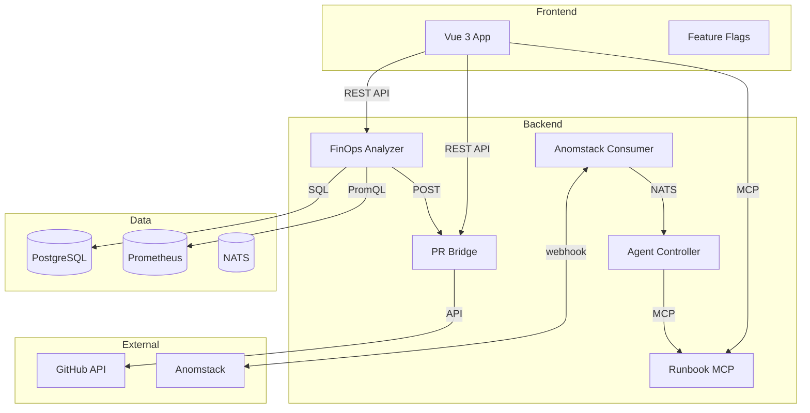

# Rufkis SRE Platform — UX Designer Workspace

The Rufkis SRE Platform is a comprehensive Kubernetes SRE console with four strategy themes:

1. **GitOps-Native Remediation** — AI diagnoses issues, generates YAML patches, offers "Create PR" instead of "Deploy"
2. **Automated FinOps ROI** — Continuous cost analysis, waste detection, automated right-sizing PRs
3. **Autonomous Agent Sub-Agent Layer** — Event-driven agent triage for anomaly alerts
4. **Local-First SRE Workspace** — Executable runbooks in the console

## Architecture



## Service Tree

```
rufkis/
├── cmd/
│   ├── agent-controller/    # Agent CRD lifecycle (Theme 3)
│   ├── pr-bridge/           # GitHub PR creation (Theme 1)
│   ├── runbook-mcp/         # Executable runbooks (Theme 4)
│   └── finops-analyzer/     # Waste cost analysis (Theme 2)
├── internal/
│   ├── agents/              # Agent CRD structs, controller, capabilities
│   └── adapters/anomstack/  # Anomstack event consumer (Theme 3)
├── frontend/src/            # Vue 3 components (Themes 1-4)
│   ├── components/atoms/    # PrActionCard, AgentBadge, RunbookBlock, TerminalDrawer
│   ├── components/molecules/# PrActionList, AgentActivityFeed, RunbookViewer
│   ├── components/organisms/# FinOpsWastePanel, AgentDashboard
│   ├── stores/              # finops.ts, agents.ts, runbooks.ts
│   └── api/                 # finops.ts, prs.ts, runbooks.ts
├── migrations/              # PostgreSQL schema (Themes 2)
├── deploy/k8s/              # Kubernetes manifests
├── terraform/               # Infrastructure provisioning
├── .github/workflows/       # CI/CD pipelines
├── runbooks/                # Executable runbook examples (Theme 4)
├── tests/e2e/playwright/    # E2E tests for all three frontend areas
├── docker-compose.dev.yaml  # Local development environment
└── docs/
    ├── DESIGN-SPEC.md       # Design system specification
    ├── STRATEGY-CONTENT.md  # Strategy theme content
    ├── quick-reference.md   # Build, dev, port mapping reference
    └── ASSEMBLY.md          # Assembly status
```

## Quick Start

```bash
# Prerequisites
- Go 1.22+
- Node.js 20+
- Docker (for dev services)

# Start backend dependencies
docker compose -f docker-compose.dev.yaml up -d postgres nats redis

# Start a service
go run ./cmd/pr-bridge/
go run ./cmd/finops-analyzer/

# Run tests
make test
```

## Contributing

See `AGENTS.md` for execution policies. See `CODING_STANDARDS.md` for Go coding conventions.

## Links

- [Design System Spec](docs/DESIGN-SPEC.md)
- [Strategy Content](docs/STRATEGY-CONTENT.md)
- [Quick Reference](docs/quick-reference.md)
- [Code Review](CODE-REVIEW.md)
- [Security Audit](SECURITY-AUDIT.json)
- [Work Plan](docs/WORK-PLAN.json)
